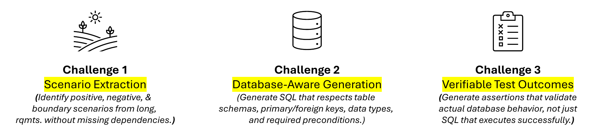
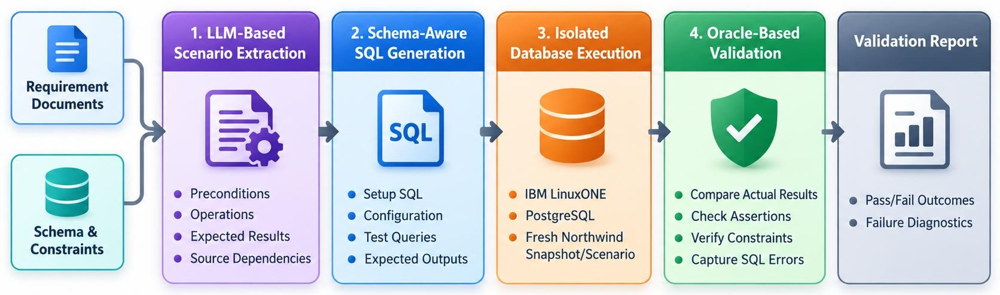

# DART: Database-Aware Requirements-to-Tests via AI-Driven Scenario Extraction and Constraint-Preserving SQL Generation

**SheQL, The University of Texas at Dallas**: Hridya Dhulipala, Raya Jahan, Jannatul Jannati, Afra Nawar, Tasfia Tasnim

DART turns requirement documents into test scenarios (Phase 1) and shows the database-aware SQL test
cases generated from them (Phase 2).

## The problem

Turning requirements into database tests takes more than understanding the text:



## How DART works



1. **LLM-based scenario extraction** (Phase 1, `doctest/`): reads the requirement documents and writes test
   scenarios with preconditions, operations, expected results and the source text they came from.
2. **Schema-aware SQL generation** (Phase 2, `DBMS_testgen/`): turns each scenario into a test case with
   setup SQL, configuration, test queries and expected outputs, using the Northwind schema and its constraints.
3. **Isolated database execution**: runs each test on a fresh Northwind database (PostgreSQL on IBM LinuxONE).
4. **Oracle-based validation**: compares actual results with expected ones, checks assertions and
   constraints, and records SQL errors, producing pass/fail results with failure details.

The web UI in `ui/` shows the results of steps 1 and 2. It does not connect to a database or run SQL.

# How to run

These steps take you from a fresh computer to the app running in your browser.

## What you need

| Tool | Why | Get it |
|---|---|---|
| Python 3.10 or newer | Runs the app | https://www.python.org/downloads/ |
| Ollama | Runs the AI model on your computer (Phase 1) | https://ollama.com/download |
| Git | Downloads the code | https://git-scm.com/downloads |

The AI model is about 5 GB, so you need that much free disk space. 8 GB of RAM or more is recommended.

To check what's already installed, open a terminal and run:

```bash
python3 --version   # must print 3.10 or higher
ollama --version
git --version
```

On Windows, use `python` instead of `python3`.

## Step 1: Download the code

```bash
git clone https://github.com/tasfia7042/IBM_Data_Divas.git
cd IBM_Data_Divas
```

Run all the commands below from this folder (the one with `ui/`, `doctest/` and `requirements.txt`).

## Step 2: Install the Python packages (one time)

This creates a virtual environment (a private folder `.venv` for this project's packages) and installs
everything into it.

**macOS / Linux**

```bash
python3 -m venv .venv
.venv/bin/pip install -r requirements.txt
```

**Windows**

```bash
python -m venv .venv
.venv\Scripts\pip install -r requirements.txt
```

This takes a minute or two. It should end with `Successfully installed ...`.

## Step 3: Download the AI model (one time)

Make sure Ollama is running first:

- **macOS / Windows**: open the Ollama app. Its icon appears in the menu bar or system tray.
- **Linux**: run `ollama serve` in a separate terminal and leave it open.

Then download the model (about 5 GB):

```bash
ollama pull qwen2.5:7b-instruct
```

Check that the app can talk to the model:

```bash
.venv/bin/doctest check          # Windows: .venv\Scripts\doctest check
```

It should print `{"ok": true}`.

## Step 4: Start the app

**macOS / Linux**

```bash
PORT=5050 .venv/bin/python ui/app.py
```

**Windows (PowerShell)**

```powershell
$env:PORT=5050; .venv\Scripts\python ui\app.py
```

When it's ready you'll see a line like `DocTest UI on http://0.0.0.0:5050`. Leave this terminal open.
The app runs only while it is open.

Open **http://localhost:5050** in your browser.

We use port 5050 because on macOS port 5000 (the app's default) is usually taken by AirPlay Receiver. If
5050 is also busy, pick another number, such as `PORT=5051`, and open that port in the browser instead.

## Step 5: Use the app

The page has three columns.

1. **Inputs (left)**: drag in or choose your files. Supported types are `.txt`, `.csv`, `.pdf`, `.md` and
   `.html`. To try it out, use the samples in the `test/` folder:
   - `test/requirement_test.txt`: requirements, one per paragraph
   - `test/northwind_requirements.pdf`: a reference document

   Then click **Run Phase 1**. This can take several minutes, depending on your computer.
2. **Scenarios (middle)**: the generated test scenarios appear here. Click a card to see its details.
   Use **Copy all** or **Download** to save them as JSON.
3. **Test cases (right)**: click **Reload file** to show the SQL test cases from
   `DBMS_testgen/results/all_tests.json`. Click a card to see its SQL. **Copy SQL script** copies it so you
   can run it yourself.

**Just want to look around?** Click **Load demo**. It fills the middle and right columns with sample data
instantly, and works even without Ollama.

**Reset** clears your uploads and scenarios so you can start over.

## Stopping and starting again

- **Stop** the app: press `Ctrl+C` in the terminal where it's running.
- **Start again later**: you don't need to repeat Steps 1–3. Open a terminal in the project folder, make sure
  Ollama is running, and run the Step 4 command.

More detail: [ui/README.md](ui/README.md) covers the UI and [doctest/README.md](doctest/README.md)
covers the Phase 1 pipeline.
